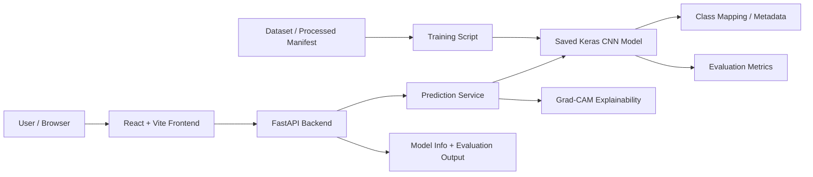

# Architecture overview

## Components

- Data layer: downloaded dataset, manifests, splits, and metadata
- Training layer: CNN and transfer-learning scripts
- Inference layer: model loading and preprocessing service
- API layer: FastAPI routes for health, prediction, explanation, and metadata
- Frontend layer: upload form, preview, prediction dashboard, and probability visualization

## Why this design works

- Separation of concerns keeps dataset handling, training, and serving independent.
- The backend loads the trained model once for efficiency.
- The frontend remains stateless except for local UI state and browser-side history.
- Saved metadata allows the dashboards to expose actual evaluation artifacts.
